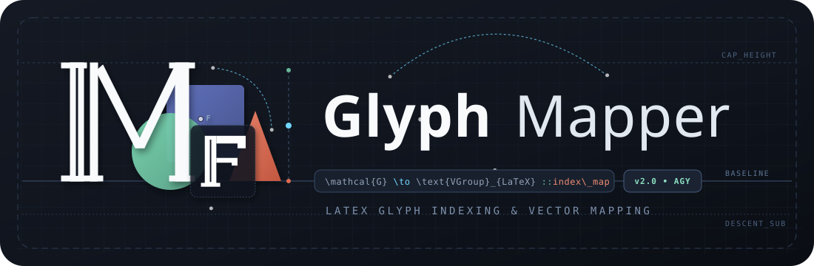
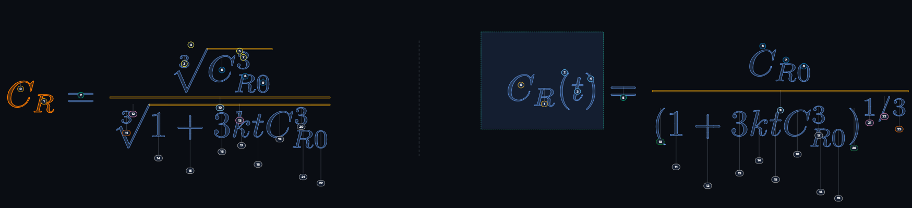
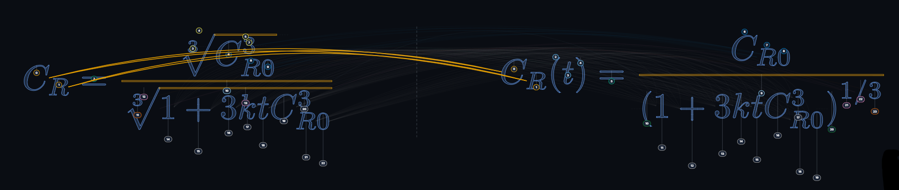

<div align="center">



[](LICENSE)
[](https://www.python.org/)
[](https://www.manim.community/)
[](https://github.com/TheMathematicFanatic/MF_Tools)
[](#instalación-3-pasos)
[](RELEASE_CHECKLIST.md)

*Visual glyph mapping for `TransformByGlyphMap` — sin adivinar índices.*

[English? → README.md](README.md)

</div>

# MF Glyph Mapper

Mapea glifos entre dos `MathTex` **visualmente** y exporta el `glyph_map` listo para
[`TransformByGlyphMap`](https://github.com/TheMathematicFanatic/MF_Tools) — sin adivinar índices.

**Regla de oro:** el índice que ves en pantalla es *exactamente* el índice que recibe
MF_Tools (submobjects reales de tu instalación de Manim, ruta `[0]` por defecto).

## Instalación (3 pasos)

```bat
pip install -r requirements.txt
```

Requisitos: Python 3.12, Manim 0.20.0, MF-Tools ≥ 1.1.3 y LaTeX (el que usa Manim).
Sin dependencias de la app: el servidor es stdlib puro.

## Uso

- **App de escritorio (Windows):** doble clic en `iniciar.vbs`
(o `app.bat` si prefieres ver la consola del servidor).
- **Manual:** desde la raíz del repo, `python web/server.py` → abre http://127.0.0.1:8765/
- **¿0 pares tras actualizar?** relanza desde el acceso directo: mata servidores viejos (solo uno puede usar el :8765).
- **Demo sin archivo propio:** botón **Probar demo** (escena de 3 pares incluida en `demo/`).

Flujo: **1 Cargar** (.py con `TransformMatchingTex`, `TransformByGlyphMap` o `ReplacementTransform` (migrable) — las
listas `GLYPH_MAP_*` literales se precargan) →
**2 Mapear** (clic A → clic B conecta; Ctrl individual, Shift rango, arrastre por zona) →
**3 Verificar** (validador con las reglas de `transforms.py`) →
**4 Exportar** (snippet + bundle `agent_bundle.json` + `AGENTE.md` para tu agente Manim) →
**5 Previa** (mp4 real + fotograma).

Atajos: `Ctrl+K` buscar par · `Ctrl+Z/Y` deshacer/rehacer · `Supr` eliminar ·
`F` encuadrar · doble clic encuadra · `Esc` limpia selección · `?` ayuda/tour.

Mapas: ✓ = cobertura total · ◐ = parcial · · = vacío. Guardado automático
(sesión + disco), sugerencias grises solo si la forma es única 1:1.

## Capturas

| Mapeo con índices reales | Arcos en abanico por conexión |
|---|---|
|  |  |
| Cada insignia es el índice exacto del subobjeto `MathTex`. Con rectángulo de selección, resaltado de libres y divisoria A\|B. | Un arco por conexión, escalonado por encima de las fórmulas. Gris = sugerencia por forma única. |

## Formato del bundle

```json
{"transitions": [{"id": "eq1->eq2", "fase": "BLOQUE 1", "glyph_map": [[[0],[0]], ...]}]}
```

## Desarrollo

- `python -m pytest tests/ -x -q` (rápidos). Puerta de release: `python scripts/release_gates.py [--full]`.
- Paleta Okabe-Ito (apta daltónicos) · tema claro/oscuro · 1024–2560px.
