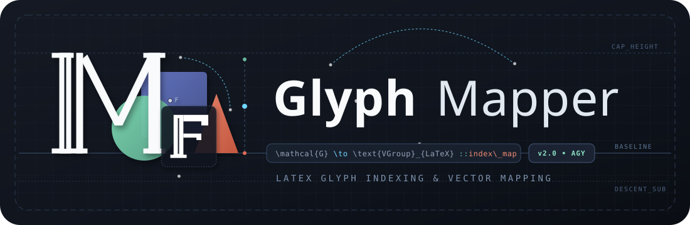
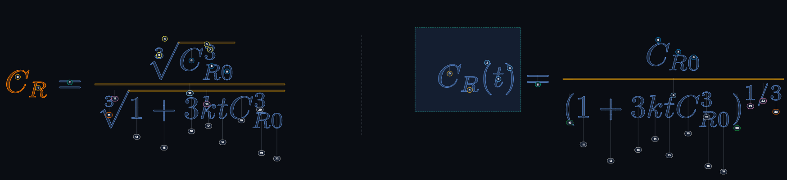
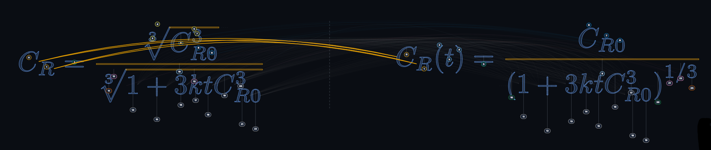

<div align="center">



[](LICENSE)
[](https://www.python.org/)
[](https://www.manim.community/)
[](https://github.com/TheMathematicFanatic/MF_Tools)
[](#install-3-steps)
[](RELEASE_CHECKLIST.md)

*Visual glyph mapping for `TransformByGlyphMap` — no index guessing.*

[¿Español? → README.es.md](README.es.md)

</div>

# MF Glyph Mapper

Map glyphs between two `MathTex` objects **visually** and export the `glyph_map`
ready for [`TransformByGlyphMap`](https://github.com/TheMathematicFanatic/MF_Tools) —
no guessing indices.

**Golden rule:** the index you see on screen is *exactly* the index MF_Tools
receives (real submobjects from your Manim install, path `[0]` by default).

## Install (3 steps)

```bat
pip install -r requirements.txt
```

Requirements: Python 3.12, Manim 0.20.0, MF-Tools ≥ 1.1.3 and LaTeX (whichever
Manim uses). No app dependencies: the server is pure stdlib.

## Usage

- **Desktop app (Windows):** double-click `iniciar.vbs`
(or `app.bat` if you prefer watching the server console).
- **Manual:** from the repo root, `python web/server.py` → open http://127.0.0.1:8765/
- **No pairs after updating?** relaunch from the desktop shortcut: it kills stale servers first (only one may hold :8765).
- **No scene file at hand:** **Try demo** button (3-pair scene bundled in `demo/`).

Flow: **1 Load** (.py with `TransformMatchingTex`, `TransformByGlyphMap` or `ReplacementTransform` (migratable) — literal
`GLYPH_MAP_*` lists are preloaded) →
**2 Map** (click A then click B to connect; Ctrl = individual, Shift = range,
drag = marquee) → **3 Verify** (validator with the `transforms.py` rules) →
**4 Export** (snippet + `agent_bundle.json` + `AGENTE.md` for your Manim agent) →
**5 Preview** (real mp4 + filmstrip frame).

Shortcuts: `Ctrl+K` find pair · `Ctrl+Z/Y` undo/redo · `Del` delete ·
`F` fit · double-click fits · `Esc` clears selection · `?` help/tour.

Maps: ✓ = full coverage · ◐ = partial · · = empty. Autosave
(session + disk), grey suggestions only for unique 1:1 shapes.

## Screenshots

| Mapping with real indices | Fan arcs per connection |
|---|---|
|  |  |
| Each badge is the exact `MathTex` subobject index. Marquee, free-glyph highlight and A\|B divider included. | One arc per connection, staggered above the formulas. Grey = unique-shape suggestion. |

## Bundle format

```json
{"transitions": [{"id": "eq1->eq2", "fase": "BLOQUE 1", "glyph_map": [[[0],[0]], ...]}]}
```

## Development

- `python -m pytest tests/ -x -q` (fast). Release gate: `python scripts/release_gates.py [--full]`.
- Okabe-Ito palette (colorblind-safe) · light/dark theme · 1024–2560px.
